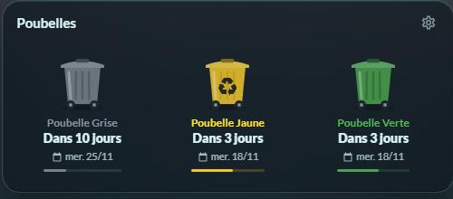
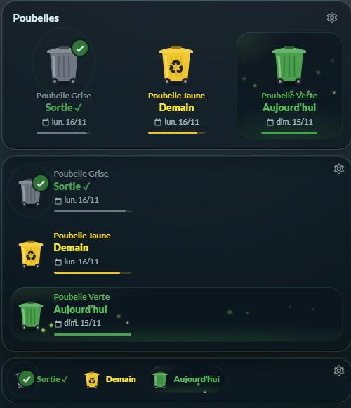
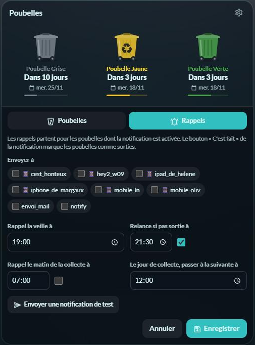
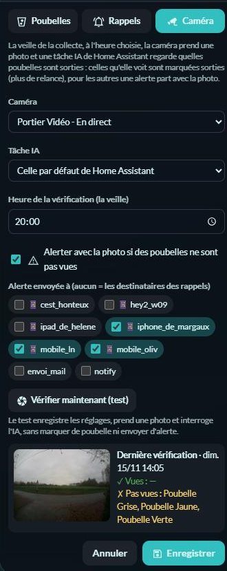
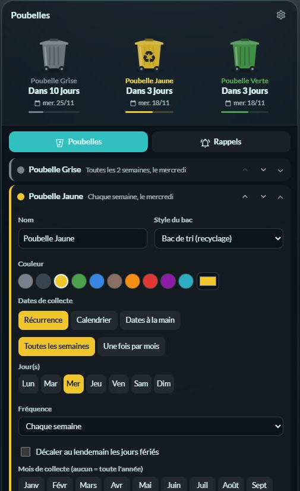

# 🗑️ HOLM Bins

[](https://hacs.xyz/)


[🇫🇷 Français](README.md) · 🇬🇧 English

**Which bin goes out, and when? Next collections, a reminder the evening before, and an animated card you set up in one click, with no template sensor or calendar to maintain.**

HOLM Bins knows the collection days of each of your bins: a **recurrence** (every Wednesday, every other Wednesday, the 1st Monday of the month…), an existing **calendar**, or **manual dates**. It gives the **next collection**, knows when a bin is **due to go out**, **reminds you the evening before** and remembers that it is **out**. The **HOLM Bins** card shows it all with bins drawn in your bins' colours and an **animation** when it is time to put them out.

### At a glance

- 📅 **Collection dates set from the card** (gear icon): recurrence, calendar or manual dates, with a preview of the next dates.
- 🔁 **Recurrences**: one or more days a week, every 1 to 4 weeks, or once a month (1st, 2nd, 3rd, 4th or last given day of the month).
- 🌿 **Collection months** (garden waste from March to November…), **public holidays moved** to the next day, **added dates** and **cancelled dates**.
- 🔔 **Reminder the day before** at the time you choose, **follow-up** if the bin is not out yet, optional reminder on the morning itself. Can be turned on **bin by bin**.
- ✅ **"Done" button** in the notification, tap on the card, switch or automation: the bin is **out**, no more follow-ups.
- ✨ **Animation of your choice for the day before, collection day and once put out**: 8 built-in animations, plus every ambience of [HOLM FX](https://github.com/kaaribou/holm-fx-card) when it is installed.
- 📷 **Camera check**: on the evening before, an AI task looks at your camera; bins it sees are marked out, otherwise an alert is sent with the photo.
- 🖼️ **Your own bin image**, instead of the drawing, bin by bin.
- 📥 **Imports your calendars** at setup: one bin per calendar, turned into a recurrence when collections are regular.
- 🌍 **8 languages**: French, English, German, Spanish, Italian, Dutch, Portuguese, Polish.

| The card | States: out, tomorrow, today (with HOLM FX) |
|---|---|
|  |  |

> Screenshots are in French; the card follows your Home Assistant profile language.

### 🆕 What's new in 1.1.0

- 🖼️ **Custom bin image**: upload your image from the card (or give an address) to replace the drawing. See [Bin image](#bin-image).
- 📷 **Camera check**: on the day before, at the chosen time, the camera and an AI task check that the bins are out; alert with the photo otherwise. See [Camera check](#camera-check).

---

## Installation

### With HACS (recommended)

1. HACS → ⋮ menu → **Custom repositories** → add `https://github.com/kaaribou/holm-bins`, category **Integration**.
2. Search for **HOLM Bins** → **Download**, then restart Home Assistant.

### Manually

Copy `custom_components/holm_bins` into the `custom_components` folder of your configuration, then restart Home Assistant.

## Configuration

**Settings → Devices & services → Add integration → HOLM Bins.**

1. **Calendars to import** (optional): calendars whose name suggests bins (bin, trash, waste, garbage, collection…) are already ticked. One bin is created for each, with a colour guessed from its name.
2. **Convert to a recurrence when possible**: if a calendar's collections always fall on the same day, every N weeks, the bin uses a recurrence you edit from the card. Otherwise it keeps reading the calendar.

Then **everything is set from the card**: add the HOLM Bins card and open the ⚙ gear (administrators).

## Entities

Each bin is a device with four entities (`<bin>` = id derived from the name, e.g. `yellow_bin`). Entity ids keep their French suffixes in every language:

| Entity | Value |
|---|---|
| `sensor.<bin>_prochaine_collecte` | Next collection date. Attributes: `jours` (days), `etat` (state), `sortie` (out), `a_sortir` (due), `prochaines_dates` (next 6), `couleur`, `style`, `image`, `notification`, `animation_veille`, `animation_jour`, `animation_sortie`, `source` |
| `sensor.<bin>_jours` | Days until the collection (0 = today) |
| `binary_sensor.<bin>_a_sortir` | On the day before from the reminder time, and on collection day until the end time, as long as the bin is not out |
| `switch.<bin>_sortie` | Bin put out for the next collection. Resets itself after the collection |

**The `etat` attribute** is `plus_tard` (3 days or more), `bientot` (day after tomorrow), `veille` (tomorrow), `aujourdhui` (today), `sortie` (out) or `aucune` (no collection scheduled).

**On collection day**, at the chosen end time (12:00 by default), the bin moves on to the next collection: the collection is done.

**Event** `holm_bins_a_sortir` at the reminder time the day before (`bins`, `names`, `date`), for your own announcements (TTS, LaMetric…):

```yaml
triggers:
  - trigger: event
    event_type: holm_bins_a_sortir
actions:
  - action: tts.speak
    target:
      entity_id: tts.google_en_com
    data:
      media_player_entity_id: media_player.kitchen
      message: "Tonight, put out: {{ trigger.event.data.names | join(' and ') }}."
```

**Mark a bin as out** from an automation (camera detection, position sensor…):

```yaml
actions:
  - action: switch.turn_on
    target:
      entity_id: switch.yellow_bin_sortie
```

**Action** `holm_bins.check_camera`: runs the camera check right away (see below), with the same effect as at the scheduled time.

## Reminders

**Reminders** tab of the card settings:

| Setting | Purpose | Default |
|---|---|---|
| **Send to** | The notification services that get the reminders (📱 = Home Assistant mobile app) | none |
| **Reminder the day before at** | Time of the reminder "Tonight: Yellow bin and Green bin (collection tomorrow, Wednesday 18/11)" | 19:00 |
| **Follow-up if not out at** | Second reminder, only for bins not out yet (tick the box to turn it on) | 21:30 |
| **Reminder on collection morning at** | Reminder on the day itself, if the bin is still not out (tick box) | off |
| **On collection day, move to the next one at** | Time from which today's collection counts as done | 12:00 |
| **Send a test notification** | Saves the settings and sends a test message to the ticked devices | |

Bins of the same collection are grouped into **one notification**. On the mobile app it has a **"Done"** button: it marks those bins as out and the notification is cleared from the other devices. Only bins with **Reminder notification** ticked are announced.



## Camera check

Do you put the bins out the evening before? A camera that sees the entrance can check it is done. **Camera** tab of the card settings:

| Setting | Purpose | Default |
|---|---|---|
| **Camera** | The camera that sees where the bins are left. "None" turns the check off | none |
| **AI task** | The Home Assistant AI task entity that analyses the photo (Google Gemini, OpenAI, Ollama…). Empty: the default one set in Home Assistant | default |
| **Check time (the day before)** | Time the photo is taken, the day before each collection | 20:00 |
| **Alert with the photo if bins are not seen** | Sends the "📷 Bins not out" alert with the photo and the "Done" button | yes |
| **Alert sent to** | Alert recipients; none ticked = the reminder recipients | none |
| **Check now (test)** | Saves the settings, takes a photo and asks the AI right away, without marking any bin or sending an alert | |
| **Last check** | The photo of the last check, its time, bins seen ✓ and not seen ✗ (or the error met) | |

**What happens**: only bins that are due and not yet marked out are checked. The AI task gets the photo and the list of bins (name, colour, style) and answers, for each, whether it is visible. Bins it sees are **marked out**: no more follow-ups for them. For the others, the **alert** is sent. A `holm_bins_verification` event (`seen`, `missing`, `names_missing`, `image`, `error`) lets you add your own announcements (LaMetric, TTS…). The photo is saved to `www/holm_bins/derniere_verification.jpg`.

> You need an integration that provides an **AI task** (*Settings → Devices & services*, e.g. Google Gemini or OpenAI). Results depend on the camera and the lighting: at night, an infrared camera makes colours hard to tell apart.

```yaml
# Example: announce on another device the bins the camera cannot see
triggers:
  - trigger: event
    event_type: holm_bins_verification
conditions:
  - condition: template
    value_template: "{{ trigger.event.data.missing | count > 0 }}"
actions:
  - action: notify.mobile_app_tablet
    data:
      message: "Not out yet: {{ trigger.event.data.names_missing | join(', ') }}"
```



## The HOLM Bins card

Added to the dashboard resources automatically: add the **HOLM Bins** card.

```yaml
type: custom:holm-bins-card
title: Bins
layout: row          # row, list or compact
```

### What the card shows

For each bin:

| Element | Meaning |
|---|---|
| **The bin** | Drawn in the bin's colour, in the chosen style: wheelie bin, recycling bin (recycle symbol), food / garden waste bin (leaf), paper / cardboard bin (box), glass bank (bottle) or bag. Or your own image (see [Bin image](#bin-image)) |
| **The name** | Written in the bin's colour |
| **The delay** | "In 10 days", "Tomorrow", "Today", "Out ✓" or "No collection scheduled". It takes the bin's colour the day before and on collection day, and turns green once out |
| **The date** 📅 | Day of the next collection ("Wed 18/11") |
| **The approach bar** | Fills up as the collection gets closer: empty right after a collection, full on collection day (based on the gap between two collections) |
| **The green tick** ✓ | The bin is out for the next collection |
| **The animation** | The one chosen for the day before, collection day or once out (see below) |
| **The gear** ⚙ | Opens the settings below the card (administrators only) |

**Tapping a bin** on the day before or on collection day marks it **out** (or undoes it). The rest of the time it opens the bin's details (`tap_action` option).

### Animations

Each bin has three animations, chosen in its settings: **the day before**, **collection day** and **once out**. "None" keeps the bin still.

| Built-in animation | Effect |
|---|---|
| Pulse | A halo in the bin's colour pulses around its box |
| Glowing halo | A glow breathes behind the bin |
| Lid opening | The lid lifts regularly |
| Shake | The bin wiggles |
| Bounce | The bin hops |
| Blinking outline | An outline in the bin's colour blinks |
| Passing truck | A small truck drives across the bottom of the box |
| Success tick | The green tick bounces with a ripple around it (meant for "once out") |

With a custom image, "Lid opening" becomes a gentle sway of the image; the other animations stay the same.

**With [HOLM FX](https://github.com/kaaribou/holm-fx-card)** installed, all its ambiences (Garden, Flames, Radar, Golden stars, Fireworks…) are added to the list and play in the background of the bin's box. The ▶ button next to each animation shows it on the card for 8 seconds. Animations stop when the device asks for reduced motion.

### Bin settings (⚙ gear)

**Bins** tab: one row per bin (colour, name, summary of the dates). The arrows change the display order; tapping the row opens its settings:

| Setting | Purpose |
|---|---|
| **Name** | Displayed name and device name |
| **Bin style** | Shape and symbol of the drawn bin |
| **Bin image** | **HOLM drawing** (the bin drawn in the chosen colour) or **Custom image** (see below) |
| **Colour** | 10 ready-made colours, or any colour with the picker |
| **Collection dates** | **Recurrence**, **Calendar** (any Home Assistant calendar: local, ICS, Google…) or **Manual dates** |
| **Weekly** / **Once a month** | Recurrence type |
| **Day(s)** | One or more days of the week |
| **Frequency** | Every week, or every 2, 3 or 4 weeks |
| **A known collection date** | For every 2 weeks or more: a date on which a collection does happen, to set the rhythm |
| **The … / Day** | Monthly recurrence: 1st, 2nd, 3rd, 4th or last given day of the month |
| **Move public holidays to the next day** | French public holidays (Easter, Ascension, Pentecost included) |
| **Collection months** | Months with collections; none ticked = all year |
| **Added dates** / **Cancelled dates** | Exceptional extra or cancelled collections |
| **Next collections** | Preview of the next 6 dates with the current settings, before saving |
| **Reminder notification** | Include this bin in the reminders |
| **Animation the day before / on collection day / once put out** | Animation for each moment, and ▶ to see it on the card |
| **Delete this bin** | Tap twice to confirm; its entities are removed when you save |

**Add a bin** creates a new one (every week, on today's weekday). **Save** applies everything at once, without a restart.



### Bin image

In a bin's settings, choose **Custom image**:

- **Upload an image**: pick a file on your device. It is stored in Home Assistant (like the images of Image cards) and becomes the bin image right away.
- or enter an **address**: `/local/images/my-bin.png` for a file in the `www` folder, or an `https://…` address.
- The **preview** on the left shows the chosen image. Going back to **HOLM drawing** removes the image.

A **PNG or SVG with a transparent background**, roughly square, looks best. It keeps the green "out" tick, the delay, the date and the animations.

### Card options

| Option | Description | Default |
|---|---|---|
| `language` | Card language: `fr`, `en`, `de`, `es`, `it`, `nl`, `pt`, `pl` | profile language |
| `title` | Title above the bins | none |
| `layout` | `row` (side by side), `list` (one per line) or `compact` (pills: bin and delay only, ideal for a navigation bar) | `row` |
| `bins` | List of bins to show (ids), in this order | all |
| `sort` | `date`: next collection first | settings order |
| `hide_after` | Hide bins whose collection is more than N days away (0 = never) | `0` |
| `tap_action` | `out` (mark out the day before and on collection day, otherwise details), `more-info` or `none` | `out` |
| `show_date` | Show the date | `true` |
| `show_progress` | Show the approach bar | `true` |
| `fx` | Use the chosen HOLM FX ambiences | `true` |
| `show_settings` | ⚙ Settings button (administrators only) | `true` |

The visual editor is available.

## Good to know

- **You had "Bin …" template sensors**: they keep working; HOLM Bins entities have different names (`_prochaine_collecte`, `_jours`…). Remove them when you no longer need them.
- **Calendar source**: the calendar is read again every hour and as soon as it changes. Collection months and added or cancelled dates apply too.
- **Notifications** use `notify.*` services: mobile app, but also e-mail, Telegram… (the "Done" button only exists on the mobile app).

## FAQ

**A collection falls on a public holiday and is not moved.** Tick *Move public holidays to the next day* (recurrences only), or add and cancel the date by hand.

**The bin stays "Today" all day.** Set *On collection day, move to the next one at* in the Reminders tab.

**I get no reminder.** Tick at least one device in *Send to*, check *Reminder notification* on the bin, and try *Send a test notification*.

---

## Say thanks?

Enjoying the integration? You can buy me a beer 🍺

[](https://paypal.me/kaaribou)

---

## License

Code: **MIT** license — © kaaribou. See the [CHANGELOG](CHANGELOG.md).

Part of **HOLM — Home Orchestration & Living Management**: smart management and orchestration of the home.

Other projects: [Volets HOLM](https://github.com/kaaribou/volets-holm) · [Climat HOLM](https://github.com/kaaribou/climat-holm) · [Carburant HOLM](https://github.com/kaaribou/carburant-holm) · [Commandes à la maison HOLM](https://github.com/kaaribou/commandes-holm) · [HOLM LaMetric](https://github.com/kaaribou/lametric-holm) · [HOLM My Menu](https://github.com/kaaribou/holm-mymenu) · [HOLM Lektrico](https://github.com/kaaribou/lektrico-holm) · [HOLM GitHub](https://github.com/kaaribou/github-holm) · [HOLM Cars](https://github.com/kaaribou/holm-cars) · [HOLM HP/HC](https://github.com/kaaribou/holm-tarif) · [HOLM Navbar Card](https://github.com/kaaribou/holm-navbar-card) · [HOLM Climate Card](https://github.com/kaaribou/climate-card-holm) · [HOLM Music Card](https://github.com/kaaribou/holm-music-card) · [HOLM Sentinel Card](https://github.com/kaaribou/holm-sentinel-card) · [HOLM Security Card](https://github.com/kaaribou/holm-security-card) · [HOLM Recordings Card](https://github.com/kaaribou/holm-recordings-card) · [HOLM Covers Card](https://github.com/kaaribou/holm-covers-card) · [HOLM Runtime Card](https://github.com/kaaribou/holm-runtime-card) · [HOLM Power Flow Card](https://github.com/kaaribou/holm-power-flow-card) · [HOLM Energy Cards](https://github.com/kaaribou/holm-energy-cards) · [HOLM Radiator Card](https://github.com/kaaribou/holm-radiator-card) · [HOLM Floor Card](https://github.com/kaaribou/holm-floor-card) · [HOLM Ecojoko Card](https://github.com/kaaribou/holm-ecojoko-card) · [HOLM Smoke Card](https://github.com/kaaribou/holm-smoke-card) · [HOLM Family Card](https://github.com/kaaribou/holm-family-card) · [HOLM Live Power Card](https://github.com/kaaribou/holm-live-power-card) · [HOLM Solar Optimizer Card](https://github.com/kaaribou/holm-solar-optimizer-card) · [HOLM Govee Light Card](https://github.com/kaaribou/holm-govee-light-card) · [HOLM Leapmotor Card](https://github.com/kaaribou/holm-leapmotor-card).
