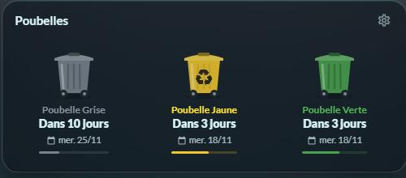
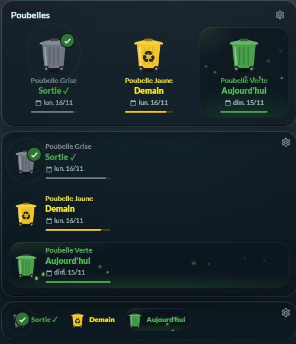
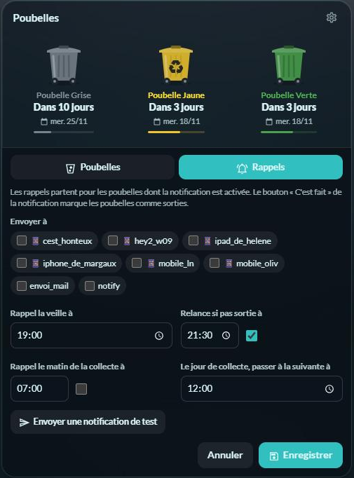
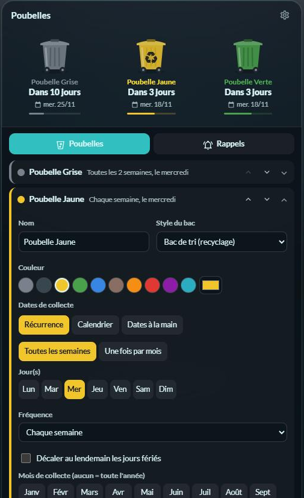

# 🗑️ HOLM Poubelles

[](https://hacs.xyz/)


🇫🇷 Français · [🇬🇧 English](README.en.md)

**Quelle poubelle sortir, et quand ? Les prochaines collectes, un rappel la veille, et une carte animée qui se règle d'un clic, sans capteur modèle ni calendrier à tenir à jour.**

HOLM Poubelles connaît les jours de collecte de chacune de vos poubelles : une **récurrence** (chaque mercredi, un mercredi sur deux, le 1er lundi du mois…), un **calendrier** existant, ou des **dates à la main**. Il annonce la **prochaine collecte**, sait quand une poubelle est **à sortir**, vous **prévient la veille** et retient qu'elle est **sortie**. La carte **HOLM Poubelles** affiche le tout avec des bacs à la couleur de vos poubelles et une **animation** au moment de les sortir.

### En bref

- 📅 **Dates de collecte réglées depuis la carte** (roue crantée) : récurrence, calendrier ou dates à la main, avec un aperçu des prochaines dates.
- 🔁 **Récurrences** : un ou plusieurs jours par semaine, toutes les 1 à 4 semaines, ou une fois par mois (1er, 2e, 3e, 4e ou dernier jour du mois).
- 🌿 **Mois de collecte** (déchets verts de mars à novembre…), **jours fériés décalés** au lendemain, **dates ajoutées** et **dates annulées**.
- 🔔 **Rappel la veille** à l'heure choisie, **relance** si la poubelle n'est pas sortie, rappel le matin même en option. Activable **poubelle par poubelle**.
- ✅ **Bouton « C'est fait »** dans la notification, appui sur la carte, interrupteur ou automatisation : la poubelle est **sortie**, plus de relance.
- ✨ **Animation au choix pour la veille, le jour de collecte et une fois sortie** : 8 animations intégrées, et toutes les ambiances de [HOLM FX](https://github.com/kaaribou/holm-fx-card) si elle est installée.
- 📥 **Reprise de vos calendriers** à l'installation : une poubelle par calendrier, convertie en récurrence quand les collectes sont régulières.
- 🌍 **8 langues** : français, anglais, allemand, espagnol, italien, néerlandais, portugais, polonais.

| La carte | Les états : sortie, demain, aujourd'hui (avec HOLM FX) |
|---|---|
|  |  |

---

## Installation

### Avec HACS (recommandé)

1. HACS → menu ⋮ → **Dépôts personnalisés** → ajoutez `https://github.com/kaaribou/holm-bins`, catégorie **Intégration**.
2. Recherchez **HOLM Poubelles** → **Télécharger**, puis redémarrez Home Assistant.

### Manuellement

Copiez `custom_components/holm_bins` dans le dossier `custom_components` de votre configuration, puis redémarrez Home Assistant.

## Configuration

**Paramètres → Appareils et services → Ajouter une intégration → HOLM Poubelles.**

1. **Calendriers à reprendre** (facultatif) : les calendriers dont le nom évoque les poubelles (poubelle, déchets, collecte, recyclage…) sont déjà cochés. Une poubelle est créée pour chacun, avec une couleur devinée d'après son nom (grise, jaune, verte, bleue, marron…).
2. **Convertir en récurrence quand c'est possible** : si les collectes d'un calendrier tombent toujours le même jour, toutes les N semaines, la poubelle utilise une récurrence que vous modifiez depuis la carte. Sinon elle continue de lire le calendrier.

Ensuite, **tout se règle depuis la carte** : ajoutez la carte HOLM Poubelles et ouvrez la roue crantée ⚙ (administrateurs).

## Entités

Chaque poubelle est un appareil, avec quatre entités (`<poubelle>` = identifiant tiré du nom, par exemple `poubelle_jaune`) :

| Entité | Valeur |
|---|---|
| `sensor.<poubelle>_prochaine_collecte` | Date de la prochaine collecte. Attributs : `jours`, `etat`, `sortie`, `a_sortir`, `prochaines_dates` (6 prochaines), `couleur`, `style`, `notification`, `animation_veille`, `animation_jour`, `animation_sortie`, `source` |
| `sensor.<poubelle>_jours` | Nombre de jours avant la collecte (0 = aujourd'hui) |
| `binary_sensor.<poubelle>_a_sortir` | Allumé la veille à partir de l'heure du rappel, et le jour de collecte jusqu'à l'heure de fin, tant que la poubelle n'est pas sortie |
| `switch.<poubelle>_sortie` | Poubelle sortie pour la prochaine collecte. Se remet à zéro tout seul après la collecte |

**L'attribut `etat`** vaut `plus_tard` (3 jours ou plus), `bientot` (après-demain), `veille` (demain), `aujourdhui`, `sortie` ou `aucune` (pas de collecte prévue).

**Le jour de collecte**, à l'heure de fin choisie (12:00 par défaut), la poubelle passe à la collecte suivante : la collecte est faite.

**Évènement** `holm_bins_a_sortir` à l'heure du rappel de la veille (`bins`, `names`, `date`), pour vos propres annonces (TTS, LaMetric…) :

```yaml
triggers:
  - trigger: event
    event_type: holm_bins_a_sortir
actions:
  - action: tts.speak
    target:
      entity_id: tts.google_fr
    data:
      media_player_entity_id: media_player.cuisine
      message: "Ce soir, sortez : {{ trigger.event.data.names | join(' et ') }}."
```

**Marquer une poubelle sortie** depuis une automatisation (détection caméra, capteur de position…) :

```yaml
actions:
  - action: switch.turn_on
    target:
      entity_id: switch.poubelle_jaune_sortie
```

## Les rappels

Onglet **Rappels** des réglages de la carte :

| Réglage | Rôle | Par défaut |
|---|---|---|
| **Envoyer à** | Les services de notification qui reçoivent les rappels (📱 = application mobile Home Assistant) | aucun |
| **Rappel la veille à** | Heure du rappel « Ce soir : Poubelle Jaune et Poubelle Verte (collecte demain, mercredi 18/11) » | 19:00 |
| **Relance si pas sortie à** | Deuxième rappel, seulement pour les poubelles pas encore sorties (case à cocher pour l'activer) | 21:30 |
| **Rappel le matin de la collecte à** | Rappel le jour même, si la poubelle n'est toujours pas sortie (case à cocher) | désactivé |
| **Le jour de collecte, passer à la suivante à** | Heure à partir de laquelle la collecte du jour est considérée comme faite | 12:00 |
| **Envoyer une notification de test** | Enregistre les réglages et envoie un message de test aux appareils cochés | |

Les poubelles d'une même collecte sont regroupées dans **une seule notification**. Sur l'application mobile, elle porte un bouton **« C'est fait »** : il marque ces poubelles comme sorties et la notification disparaît des autres appareils. Seules les poubelles dont **Notification de rappel** est cochée sont annoncées.



## La carte HOLM Poubelles

Ajoutée automatiquement aux ressources du tableau de bord : ajoutez la carte **HOLM Poubelles**.

```yaml
type: custom:holm-bins-card
title: Poubelles
layout: row          # row, list ou compact
```

### Ce que montre la carte

Pour chaque poubelle :

| Élément | Signification |
|---|---|
| **Le bac** | Dessiné à la couleur de la poubelle, dans le style choisi : bac roulant, bac de tri (symbole recyclage), bac biodéchets (feuille), bac papier / carton (carton), conteneur à verre (bouteille) ou sac |
| **Le nom** | Écrit dans la couleur de la poubelle |
| **Le délai** | « Dans 10 jours », « Demain », « Aujourd'hui », « Sortie ✓ » ou « Aucune collecte prévue ». Il prend la couleur de la poubelle la veille et le jour J, et devient vert une fois sortie |
| **La date** 📅 | Jour de la prochaine collecte (« mer. 18/11 ») |
| **La barre d'approche** | Se remplit à mesure que la collecte approche : vide juste après une collecte, pleine le jour J (calculée sur l'écart entre deux collectes) |
| **La coche verte** ✓ | La poubelle est sortie pour la prochaine collecte |
| **L'animation** | Celle choisie pour la veille, le jour de collecte ou une fois sortie (voir ci-dessous) |
| **La roue crantée** ⚙ | Ouvre les réglages sous la carte (administrateurs seulement) |

**Un appui sur une poubelle** la veille ou le jour J la marque **sortie** (ou annule). Le reste du temps, il ouvre le détail de la poubelle (option `tap_action`).

### Les animations

Chaque poubelle a trois animations, choisies dans ses réglages : **la veille (J-1)**, **le jour de collecte** et **une fois sortie**. « Aucune » laisse le bac immobile.

| Animation intégrée | Effet |
|---|---|
| Pulsation | Un halo de la couleur de la poubelle pulse autour de la case |
| Halo lumineux | Une lueur respire derrière le bac |
| Couvercle qui s'ouvre | Le couvercle se soulève régulièrement |
| Secousse | Le bac se dandine |
| Rebond | Le bac sautille |
| Contour clignotant | Un contour de la couleur de la poubelle clignote |
| Camion qui passe | Un petit camion traverse le bas de la case |
| Coche de réussite | La coche verte rebondit et une onde l'entoure (prévue pour « une fois sortie ») |

**Avec [HOLM FX](https://github.com/kaaribou/holm-fx-card)** installée, toutes ses ambiances (Jardin, Flammes, Radar, Étoiles dorées, Feux d'artifice…) s'ajoutent à la liste et s'affichent en fond de la case de la poubelle. Le bouton ▶ à côté de chaque animation la montre 8 secondes sur la carte. Les animations s'arrêtent si l'appareil demande à réduire les animations.

### Les réglages des poubelles (roue crantée ⚙)

Onglet **Poubelles** : une ligne par poubelle (couleur, nom, résumé des dates). Les flèches changent l'ordre d'affichage, un appui sur la ligne ouvre ses réglages :

| Réglage | Rôle |
|---|---|
| **Nom** | Nom affiché et nom de l'appareil |
| **Style du bac** | Forme et symbole du bac dessiné |
| **Couleur** | 10 couleurs prêtes à l'emploi, ou n'importe quelle couleur avec le sélecteur |
| **Dates de collecte** | **Récurrence**, **Calendrier** (un calendrier Home Assistant : local, ICS, Google…) ou **Dates à la main** |
| **Toutes les semaines** / **Une fois par mois** | Type de récurrence |
| **Jour(s)** | Un ou plusieurs jours de la semaine |
| **Fréquence** | Chaque semaine, ou toutes les 2, 3 ou 4 semaines |
| **Une date de collecte connue** | Pour les fréquences de 2 semaines ou plus : une date où la collecte a bien lieu, pour caler le rythme |
| **Le … / Jour** | Récurrence mensuelle : 1er, 2e, 3e, 4e ou dernier jour donné du mois |
| **Décaler au lendemain les jours fériés** | Jours fériés français (Pâques, Ascension, Pentecôte compris) |
| **Mois de collecte** | Mois où la collecte a lieu ; aucun mois coché = toute l'année |
| **Dates ajoutées** / **Dates annulées** | Collectes exceptionnelles en plus ou en moins |
| **Prochaines collectes** | Aperçu des 6 prochaines dates avec les réglages en cours, avant d'enregistrer |
| **Notification de rappel** | Inclure cette poubelle dans les rappels |
| **Animation la veille / le jour de collecte / une fois sortie** | Animation de chaque moment, et ▶ pour la voir sur la carte |
| **Supprimer cette poubelle** | Deux appuis pour confirmer ; ses entités sont retirées à l'enregistrement |

**Ajouter une poubelle** en crée une nouvelle (chaque semaine, le jour d'aujourd'hui). **Enregistrer** applique tout immédiatement, sans redémarrage.



### Options de la carte

| Option | Description | Par défaut |
|---|---|---|
| `language` | Langue de la carte : `fr`, `en`, `de`, `es`, `it`, `nl`, `pt`, `pl` | celle du profil |
| `title` | Titre au-dessus des poubelles | aucun |
| `layout` | `row` (côte à côte), `list` (une par ligne) ou `compact` (pastilles : bac et délai seulement, idéal pour une barre de navigation) | `row` |
| `bins` | Liste des poubelles à afficher (identifiants), dans cet ordre | toutes |
| `sort` | `date` : la prochaine collecte d'abord | ordre des réglages |
| `hide_after` | Masquer les poubelles dont la collecte est dans plus de N jours (0 = jamais) | `0` |
| `tap_action` | `out` (marquer sortie la veille et le jour J, sinon détails), `more-info` ou `none` | `out` |
| `show_date` | Afficher la date | `true` |
| `show_progress` | Afficher la barre d'approche | `true` |
| `fx` | Utiliser les ambiances HOLM FX choisies | `true` |
| `show_settings` | Bouton ⚙ Réglages (administrateurs seulement) | `true` |

L'éditeur visuel est disponible.

## Bon à savoir

- **Vous aviez des capteurs modèles « Poubelle … »** : ils continuent de fonctionner, les entités de HOLM Poubelles ont des noms différents (`_prochaine_collecte`, `_jours`…). Supprimez-les quand vous n'en avez plus besoin.
- **Source Calendrier** : le calendrier est relu toutes les heures et dès qu'il change. Les mois de collecte et les dates ajoutées ou annulées s'appliquent aussi.
- **Les notifications** utilisent les services `notify.*` : application mobile, mais aussi e-mail, Telegram… (le bouton « C'est fait » n'existe que sur l'application mobile).

## FAQ

**Une collecte tombe un jour férié et n'est pas décalée.** Cochez *Décaler au lendemain les jours fériés* (récurrences uniquement), ou ajoutez et annulez la date à la main.

**La poubelle reste « Aujourd'hui » toute la journée.** Réglez l'heure *Le jour de collecte, passer à la suivante à* dans l'onglet Rappels.

**Je ne reçois pas de rappel.** Cochez au moins un appareil dans *Envoyer à*, vérifiez *Notification de rappel* sur la poubelle, et essayez *Envoyer une notification de test*.

---

## Un petit merci ?

L'intégration vous plaît ? Vous pouvez m'offrir une bière 🍺

[](https://paypal.me/kaaribou)

---

## Licence

Code : licence **MIT** — © kaaribou. Voir le [CHANGELOG](CHANGELOG.md).

Fait partie de **HOLM — Home Orchestration & Living Management** : la gestion et l'orchestration intelligente de la maison.

Les autres projets : [Volets HOLM](https://github.com/kaaribou/volets-holm) · [Climat HOLM](https://github.com/kaaribou/climat-holm) · [Carburant HOLM](https://github.com/kaaribou/carburant-holm) · [Commandes à la maison HOLM](https://github.com/kaaribou/commandes-holm) · [HOLM LaMetric](https://github.com/kaaribou/lametric-holm) · [HOLM My Menu](https://github.com/kaaribou/holm-mymenu) · [HOLM Lektrico](https://github.com/kaaribou/lektrico-holm) · [HOLM GitHub](https://github.com/kaaribou/github-holm) · [HOLM Cars](https://github.com/kaaribou/holm-cars) · [HOLM HP/HC](https://github.com/kaaribou/holm-tarif) · [HOLM Navbar Card](https://github.com/kaaribou/holm-navbar-card) · [HOLM Climate Card](https://github.com/kaaribou/climate-card-holm) · [HOLM Music Card](https://github.com/kaaribou/holm-music-card) · [HOLM Sentinel Card](https://github.com/kaaribou/holm-sentinel-card) · [HOLM Security Card](https://github.com/kaaribou/holm-security-card) · [HOLM Recordings Card](https://github.com/kaaribou/holm-recordings-card) · [HOLM Covers Card](https://github.com/kaaribou/holm-covers-card) · [HOLM Runtime Card](https://github.com/kaaribou/holm-runtime-card) · [HOLM Power Flow Card](https://github.com/kaaribou/holm-power-flow-card) · [HOLM Energy Cards](https://github.com/kaaribou/holm-energy-cards) · [HOLM Radiator Card](https://github.com/kaaribou/holm-radiator-card) · [HOLM Floor Card](https://github.com/kaaribou/holm-floor-card) · [HOLM Ecojoko Card](https://github.com/kaaribou/holm-ecojoko-card) · [HOLM Smoke Card](https://github.com/kaaribou/holm-smoke-card) · [HOLM Family Card](https://github.com/kaaribou/holm-family-card) · [HOLM Live Power Card](https://github.com/kaaribou/holm-live-power-card) · [HOLM Solar Optimizer Card](https://github.com/kaaribou/holm-solar-optimizer-card) · [HOLM Govee Light Card](https://github.com/kaaribou/holm-govee-light-card) · [HOLM Leapmotor Card](https://github.com/kaaribou/holm-leapmotor-card).
